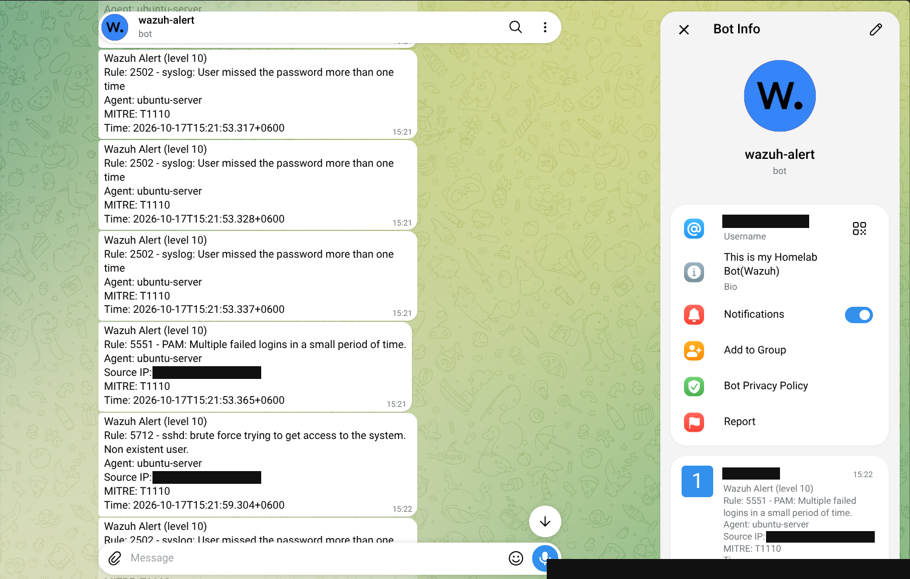

<video src="./wazuh-attack-to-alert.mp4" controls width="100%">
  Your browser does not support the video tag.
</video>

# Wazuh Purple-Team Detection Lab


A self-built home lab that uses the open-source **Wazuh** XDR/SIEM platform to run a
**purple-team detection-engineering loop**: emulate an attack, observe what the SIEM
catches (and misses), then author custom detection rules to close the gap — all mapped
to **MITRE ATT&CK** and common compliance frameworks.

> This project was built hands-on from a bare Wazuh install. It is intended as a learning
> portfolio piece and a reusable reference for anyone standing up their first detection lab.

**Author:** Md Aman Bhuiyan — Security Engineer, Vivasoft Limited (Red Team & Bug Bounty background)

---

## Why this project exists

Most Wazuh home labs stop at "I installed it and here's the dashboard." The goal here was
different: to practice the actual craft of a detection engineer — reading raw telemetry,
understanding how events are decoded, and writing rules that turn generic, low-severity
noise into **specific, high-severity, attributable detections**.

The lab deliberately bridges offense and defense: attacks are launched from Kali, and the
detection coverage for each one is measured and improved on the Wazuh side.

---

## Architecture

```
            ┌────────────────────────────────────────────────┐
            │              Isolated VMware network            │
            │                   (NAT segment)                 │
            │                                                 │
   Attacker │   ┌──────────────┐        ┌──────────────────┐  │
   + SIEM   │   │  Kali Linux  │        │  Ubuntu Server   │  │
   host ────┼──▶│  Wazuh       │◀──────▶│  Wazuh Agent     │  │
            │   │  Manager     │  1514  │  + Apache/DVWA   │  │
            │   │  Indexer     │  1515  │  + MariaDB       │  │
            │   │  Dashboard   │        └──────────────────┘  │
            │   └──────┬───────┘                              │
            │          │               ┌──────────────────┐  │
            │          └──────────────▶│  Windows (VMware)│  │
            │                   1514   │  Wazuh Agent     │  │
            │                          └──────────────────┘  │
            └────────────────────────────────────────────────┘
```

| Component | Role | Where it runs |
|-----------|------|---------------|
| **Wazuh Manager** | Receives agent telemetry, runs decoders + rules, generates alerts | Kali Linux |
| **Wazuh Indexer** | Stores and indexes alerts for search | Kali Linux (lab-consolidated) |
| **Wazuh Dashboard** | Web UI for threat hunting, events, compliance views | Kali Linux (lab-consolidated) |
| **Wazuh Agent (Linux)** | Ships auth + web-server logs; hosts the vulnerable web app | Ubuntu Server VM |
| **Wazuh Agent (Windows)** | Endpoint telemetry source | Windows VM |
| **DVWA** | Deliberately vulnerable web app used as an attack target | Ubuntu Server VM |

> **Note on topology:** For a lab, the Manager, Indexer, and Dashboard are consolidated on a
> single Kali host. In production these are typically separated across dedicated nodes.

See [`ARCHITECTURE.md`](ARCHITECTURE.md) for detail.

---

## Components & versions

- **Wazuh** 4.14.x (manager, indexer, dashboard, agents)
- **Kali Linux** — Wazuh manager + attacker tooling (`hydra`, `curl`)
- **Ubuntu Server** — Wazuh agent + Apache + MariaDB + PHP + DVWA
- **Windows** — Wazuh agent (endpoint telemetry)
- **VMware** — virtualization, NAT-isolated lab network

---

## Setup & deployment

> Replace every `<PLACEHOLDER>` with your own value. Never commit real IPs, hostnames,
> passwords, or tokens.

### 1. Wazuh manager (Kali)
Install the Wazuh manager, indexer, and dashboard following the official quickstart, then
confirm the dashboard is reachable at `https://<MANAGER_IP>`.

### 2. Linux agent (Ubuntu Server)
```bash
# On the agent, add the Wazuh repo and install the agent pointed at the manager
sudo apt-get install -y gnupg apt-transport-https
curl -s https://packages.wazuh.com/key/GPG-KEY-WAZUH | \
  sudo gpg --no-default-keyring --keyring gnupg-ring:/usr/share/keyrings/wazuh.gpg --import
sudo chmod 644 /usr/share/keyrings/wazuh.gpg
echo "deb [signed-by=/usr/share/keyrings/wazuh.gpg] https://packages.wazuh.com/4.x/apt/ stable main" | \
  sudo tee /etc/apt/sources.list.d/wazuh.list
sudo apt-get update
sudo WAZUH_MANAGER="<MANAGER_IP>" WAZUH_AGENT_NAME="ubuntu-server" apt-get install -y wazuh-agent
sudo systemctl daemon-reload && sudo systemctl enable --now wazuh-agent
```
Confirm the agent shows **Active** in the dashboard under **Agents**.

### 3. Vulnerable web app (DVWA)
See [`dvwa-install-notes.md`](dvwa-install-notes.md) for the full Apache +
MariaDB + DVWA setup used in this lab.

### 4. Enable web-log monitoring on the agent
Add the Apache access-log source to the agent config (excerpt in
[`agent-ossec.conf.example`](agent-ossec.conf.example)), then restart the agent.

### 5. Deploy custom detection rules (on the manager)
Custom rules live on the **manager**, not the agent:
```bash
# On Kali (manager)
sudo cp local_rules.xml /var/ossec/etc/rules/local_rules.xml
sudo /var/ossec/bin/wazuh-logtest     # validate BEFORE restarting
sudo systemctl restart wazuh-manager
```

---

## Configuration highlights

- **Agent log collection:** Linux auth log is monitored by default; the Apache access log
  is added explicitly so web attacks become visible. See `agent-ossec.conf.example`.
- **Custom rules in the reserved range:** All custom rules use IDs `100000+` so they never
  clash with Wazuh's built-in ruleset. See `local_rules.xml`.
- **Safe iteration with `wazuh-logtest`:** Rules are validated against a sample log line
  before the manager is restarted, so a syntax error never takes the SIEM offline.

---

## Usage examples (attack → detect)

All attacks are launched from Kali against the lab agents. See
[`attack-simulations.sh`](attack-simulations.sh).

### SSH brute force
```bash
hydra -l fakeuser -P /usr/share/wordlists/rockyou.txt ssh://<AGENT_IP> -t 4
```
Detected out-of-the-box by Wazuh's SSH rules.

### Web attack (SQL injection / path traversal) against DVWA
```bash
curl "http://<AGENT_IP>/dvwa/vulnerabilities/sqli/?id=1' OR '1'='1&Submit=Submit"
curl "http://<AGENT_IP>/dvwa/vulnerabilities/fi/?page=../../../../etc/passwd"
```
Detected via the `web-accesslog` decoder and Wazuh's web-attack rules — then escalated by a
custom rule (below).

---

## Real-time Telegram alerting

High-severity detections are pushed to a Telegram bot in real time via Wazuh's
`wazuh-integratord` daemon and a custom script on the manager. A `<level>10</level>` threshold
keeps routine noise off the phone while still delivering the SSH brute force (rule 5712) and
the custom path-traversal rule (100100).

Live alerts during an SSH brute force against the Ubuntu agent (source IP and bot username
redacted):



Setup, scripts, and troubleshooting: [`integrations/README.md`](integrations/README.md).

## Key detections

> Screenshots: _add your own exported event screenshots to `docs/screenshots/` and link
> them here._ Numbers below reflect what was observed during the build; **re-run and confirm
> your own measured values before publishing.**

| Attack | Technique (ATT&CK) | Built-in rule | Observed result |
|--------|--------------------|---------------|-----------------|
| SSH brute force | **T1110** Brute Force | `5710` failed login (lvl 5), **`5712`** brute force (lvl 10) | Repeated failed logins correlated into a single brute-force verdict |
| Web attack (SQLi / traversal) | **T1190** Exploit Public-Facing App, **T1083** File & Directory Discovery | **`31104`** "Common web attack" (lvl 6) | Payload captured via `web-accesslog` decoder; auto-tagged to PCI DSS / NIST |
| Path traversal to `/etc/passwd` | **T1083** File & Directory Discovery | **`100100`** *(custom, lvl 12)* | Generic lvl-6 alert escalated into a specific, high-severity, attacker-attributed detection |

**The headline result:** a generic built-in web alert (`31104`, level 6) was upgraded into a
**custom level-12 detection** (`100100`) that names the technique and embeds the attacker's
source IP in the alert text — the core of detection engineering.

See the custom rule in [`local_rules.xml`](local_rules.xml).

---

## Lessons baked into this repo

- **The manager decides, the agent collects.** Rules are evaluated on the manager — putting
  them on the agent does nothing.
- **Validate before you ship.** `wazuh-logtest` catches XML/logic errors before a restart.
- **A detection isn't live until** the manager is restarted *and* a fresh event arrives.
- **Networking first.** Agents and manager must share a reachable subnet; most "agent won't
  connect" issues are network-mode mismatches, not Wazuh.

Full write-up: [`LEARNING_SUMMARY.md`](LEARNING_SUMMARY.md).

---

## Roadmap

- [x] **Real-time Telegram alerting** for level-10+ detections (see `integrations/`)

- [ ] Add more custom Linux rules (web-shell upload, directory scanning / repeated 404s, reverse-shell process spawn)
- [ ] Install **Sysmon** on the Windows agent and author a Windows detection (e.g. suspicious PowerShell download)
- [ ] Build a **MITRE ATT&CK Navigator** coverage heatmap from the detected techniques
- [ ] Add **active response** (auto-block attacker IP on a high-severity rule)
- [ ] Explore enrichment integrations (VirusTotal on FIM, vulnerability detection module)
- [ ] Extend to an **Active Directory** scenario (e.g. GOAD) for AD attack detections

---

## Repository layout

See [`ARCHITECTURE.md`](ARCHITECTURE.md) and the tree below:

```
.
├── README.md
├── ARCHITECTURE.md
├── LICENSE
├── CONTRIBUTING.md
├── .gitignore
├── LEARNING_SUMMARY.md
├── Wazuh_Purple_Team_Lab_Learning_Summary.pdf
├── agent-ossec.conf.example         # Agent log-collection excerpt
├── attack-simulations.sh            # Reproducible attack commands
├── dvwa-install-notes.md            # Vulnerable web app setup
├── local_rules.xml                  # Custom detection rules (ID 100000+)
├── integrations/
│   ├── custom-telegram.py           # Wazuh -> Telegram alert script
│   ├── custom-telegram              # Integrator wrapper
│   ├── ossec-integration-snippet.xml # <integration> config block
│   └── README.md                    # Telegram alerting setup + troubleshooting
└── docs/
    └── screenshots/
        ├── README.md
        └── redacted/
            └── 09-telegram-live-alerts.png
```

---

## Disclaimer

This lab contains **intentionally vulnerable software** (DVWA). Run it only on an **isolated
virtual network** that is not reachable from your real network or the internet. All attacks
shown here were performed against machines the author owns, inside a closed lab.

---

## License

Released under the [MIT License](LICENSE) © 2026 Md Aman Bhuiyan.
